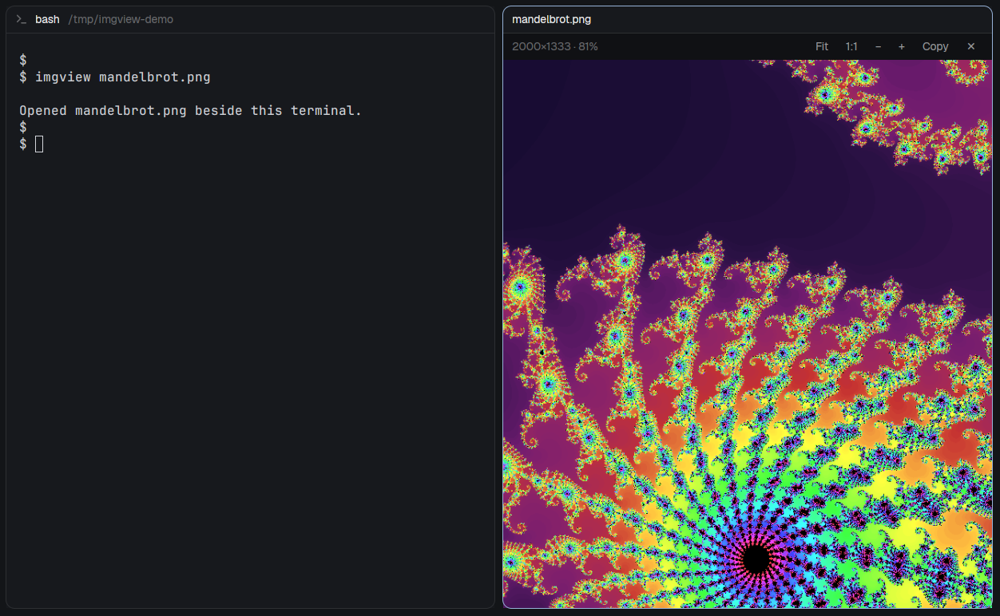

# herdr-imgview

An image viewer pane for the [Herdr](https://herdr.dev) desktop app that you can zoom and pan.
It works for images on this computer and on any machine Herdr is connected to.



- An agent runs `imgview shot.png`, or you **Ctrl-click** an image path in a terminal. The picture
  opens in a pane to the right of that terminal.
- The **wheel** zooms toward the cursor, **dragging** pans and **double-click** switches between
  fit and 100%. `c` copies the image to the clipboard and `q` closes the pane.
- When the agent re-renders the file, the viewer reloads it.

[RECIPE.md](RECIPE.md) describes everything it does, with the install steps and limits.

## Install

Paste this to your agent:

> Read ~/.config/herdr-app/AGENTS.md, then add this mod: https://github.com/salmpc/herdr-imgview

Or install it by hand:

```sh
cp -R mods/imgview mods/imgview-watch ~/.config/herdr-app/mods/
herdr-app check ~/.config/herdr-app/mods/imgview
herdr-app check ~/.config/herdr-app/mods/imgview-watch
```

Then add the watcher to your layout's root node, so agents can open images:

```json
"floating": [{ "id": "imgview-watch", "content": { "mod": "imgview-watch" }, "edge": "bottom", "align": "end" }]
```

Copy `bin/imgview` to `~/.local/bin/` on every machine whose agents should use it, and tell them
about it, for example in `CLAUDE.md`:

```
To show me an image, run: imgview /absolute/path/to/image.png
```

## What it runs

- `python3` reads the image size, and Pillow converts TIFF, HEIC and AVIF if it's installed.
- `hc exec --on <machine> cat` fetches files from other machines.
- `stat` checks for changes every 3 s.
- `xclip`, `wl-copy` or `osascript` copy to the clipboard.

It doesn't use the network, apart from herdr-core's own connections. Copies of the images are kept in
`~/.config/herdr-app/data/imgview/` and deleted when the viewer closes.

It has been tested on Linux (X11). macOS should work but hasn't been tried. Windows isn't supported.

Built with Claude Code.

## License

MIT
