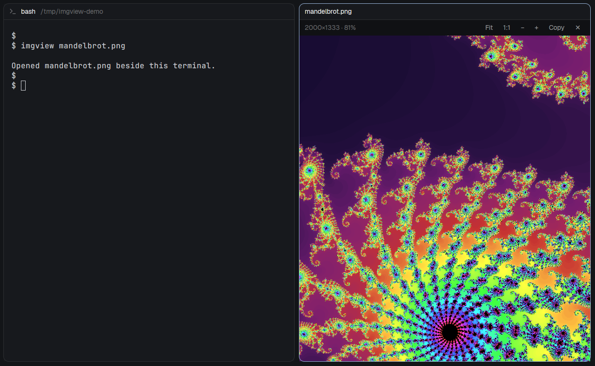

# imgview

An image viewer pane for the Herdr app that you can zoom and pan. An agent runs `imgview shot.png`, or you
Ctrl-click an image path in a terminal, and the picture opens in a pane to the right of that terminal.
This works the same when the terminal is on another machine Herdr is connected to (a VPS, a dev container):
the file is fetched through herdr-core, so nothing has to be installed on the other machine except the
one-line `imgview` script. The mouse wheel zooms toward the cursor and dragging pans.

## What you see

- **A pane to the right of the terminal**, named after the file (`mandelbrot.png`) in the pane's own title bar.
- **A 30px toolbar** under the title: `chrome` background, 1px `border` line underneath, 12px text.
  - On the left, in `dim`: the image's real size and the current scale, plus the machine when it isn't this
    computer: `2000×1333 · 81%`, `1561×784 · 34% · vps`.
  - After a copy or a reload, a short `✓ copied` / `✓ reloaded` in `done` color for 2.5 s.
  - On the right, text buttons in `muted` that turn `foreground` on a `hover` background (7px × 2px
    padding, 5px radius): `Fit`, `1:1`, `−`, `+`, `Copy`, `✕`.
- **The image** below it on the theme's `background`. It opens fitted to the pane and never enlarged
  past 100% (a small screenshot shows at its real size), centered on any axis where it's smaller than the pane.
- While loading: `Loading shot.png from vps…` centered in `muted` 13px. On failure the reason is shown in
  `blocked` color instead: `Can't read /path on vps`, `Not an image I can read: …`, or the copy error.

## How it behaves

- **Wheel** zooms toward the point under the pointer: 1.2× per notch, at most 3 notches per event.
  **Shift+wheel** pans. A trackpad **pinch** zooms too.
- **Drag** with the left button pans. **Double-click** switches between fit and 100% at the clicked point.
- The scale stays between half of "fit" and 1600%. Wherever the image is bigger than the pane it can't be
  dragged past its edges. Where it's smaller, it stays centered.
- **Keys** (click the image to give it the keyboard): `+` / `=` zoom in 1.25×, `-` zoom out, `0` or `f`
  fit, `1` shows 100%, the arrows pan 80px, `c` copies, `r` reloads, `q` or `Esc` closes the pane.
- **Commands** for keys.json or `herdr-app do`: `imgview.zoom-in`, `zoom-out`, `fit`, `actual`, `copy`,
  `reload`, `close`.
- **Copy** puts the full-size image on the clipboard as PNG. On Linux it uses `xclip`, or `wl-copy` under
  Wayland; on macOS it uses `osascript`. Non-PNG images are converted first.
- **Reload**: every 3 s the viewer checks the file's size and modification time. When an agent re-renders
  the file, the new version replaces the old one. The view stays where it was if the size didn't change.
- **Resizing** the pane refits while you're in fit mode, and otherwise keeps the view clamped.
- **One viewer per tab**: opening another image in a tab closes that tab's existing imgview first.
- If the tab isn't the one being shown, a toast says `Image opened` (`shot.png, beside <title>`).
  Clicking the toast focuses the terminal the image came from.
- Agent status is not used. The viewer looks the same whatever the agents are doing.

## Built from

Two mods and a script.

- `mods/imgview/` (`place: none`, `focusable: true`)
  - `main.js` is the viewer pane. It takes props `{ file, on }`: an absolute path, and the machine
    name (`null` for this computer).
  - `link.js` handles terminal links. `mod.json` declares `link_handlers: [{ kind: "file",
    pattern: "(?i)\\.(png|jpe?g|gif|webp|bmp|tiff?|avif|heic)(:\\d+)*$" }]`.
    - `handleLink` uses `link.path`. When that's null (a remote terminal), it rebuilds the path from
      `link.raw`: it strips `file://host` and `:line` suffixes, expands `~/` with `exec("sh",
      ["-c","printf %s \"$HOME\""], {on})`, and joins relative paths onto `source.cwd`.
  - `open.js` has `openImage({ file, on, pane })`.
    1. It closes every `panes()` entry with `mod === "imgview"` in the source pane's tab.
    2. It runs `pane.split {direction: "right", pane, mod: "imgview", props: {file, on}}`.
    3. `run()` returns null, so it polls `panes()` (`exec("sleep",["0.2"])`, up to 15 times) for the
       new imgview pane and runs `pane.rename` on it with the file's name.
    4. If `focused().tab` is another tab, it calls `notify` with the action `pane.focus {pane}`.
- `mods/imgview-watch/` (`place: none`) draws nothing (`div()`). It runs as a floating block on the
  layout's root so it is always alive. Every 1000 ms it reads `terminals()`. For each terminal with the
  label `imgview.open = "<unix time>|<absolute path>"` that `panes()` shows:
  1. It runs `hc(["label", address, "imgview.open="])` to remove the label.
  2. It calls `openImage` with the machine taken from the address prefix (`vps/t3` → `vps`; a bare
     `t3` is this computer).

  It has its own copy of `open.js`, because a mod can't import from another mod's folder. With the
  optional prop `machines: ["local", "vps"]` it handles only those machines. That's for two windows
  (`HERDR_APP_HOME`) sharing one core.
- `bin/imgview FILE` (POSIX sh) runs on whichever machine the agent is on. It checks that `$HC_TERMINAL_ID`
  is set (every Herdr app terminal has it) and makes the path absolute. Then it runs
  `hc label "$HC_TERMINAL_ID" "imgview.open=$(date +%s)|$path"`.
- **Getting the image into place.** `image()` only draws files under the app home, so each load does this:
  1. Fetch the file to `<appHome>/data/imgview/<ms>-<n>.raw`. On this computer that's `cp --`. From
     another machine it's `sh -c 'hc exec --on "$1" cat -- "$2" > "$3"'` (byte-exact).
  2. Run a Python helper (`python3 -c PREP`) that prints `w h name`.
     - PNG, JPEG, GIF, WebP and BMP are copied as they are. The size comes from Pillow if it's
       installed, otherwise from a stdlib header parser (PNG IHDR, GIF, BMP, JPEG SOFn, WebP
       VP8/VP8L/VP8X).
     - TIFF, HEIC and AVIF are converted to PNG with Pillow.
  3. Draw `image("data/imgview/<name>")` positioned `absolute` with `left/top/w/h` inside a
     `relative().overflow_hidden()` canvas.
  4. Each load uses a new file name (GPUI caches by path). The previous copy is deleted. `close()`
     deletes the current one, and on start, copies older than a day are swept (`find -mmin +1440 -delete`).
- **Size check for reload.** `sh -c 'stat -c %s:%Y "$1" 2>/dev/null || stat -f %z:%m "$1"'` (GNU or
  BSD), run on the file's machine.
- **Herdr calls used.** `exec`, `hc`, `props`, `theme`, `settings().zoom`, `appHome`, `panes`,
  `terminals`, `focused`, `notify`, `run` (`pane.split`, `pane.close`, `pane.rename`, `pane.focus`),
  `nextCommand`, `checking`. From gpui-kit: `on_scroll_wheel`, `on_pinch`, `on_mouse_down/move/up`,
  `on_hover`, `on_size_change`, `track_focus`, `on_key_down`.

## Install

1. Copy `mods/imgview` and `mods/imgview-watch` to `~/.config/herdr-app/mods/`.
2. Add the watcher to your layout's root node:
   `"floating": [{ "id": "imgview-watch", "content": { "mod": "imgview-watch" }, "edge": "bottom", "align": "end" }]`.
3. Put `bin/imgview` on the PATH of every machine whose agents should open images (`~/.local/bin`).
4. Tell your agents to use it, for example in `CLAUDE.md`: "To show me an image, run `imgview /abs/path.png`."

## Watch out

- **App zoom.** Lengths you set (`w`, `left`, …) are multiplied by the app zoom (`settings().zoom`, e.g.
  1.1), but `on_size_change` sizes and mouse positions are not. Divide every measurement and pointer
  position by the zoom, or the fitted image overflows the pane at any zoom other than 100%.
- **Screenshots can be blank.** `herdr-app shot` can show the canvas empty for a moment right after a load
  while the image decodes. Shoot again before deciding it failed.
- **`run()` returns null**, so you never get the new pane's id directly (see open.js).
- **Shipped and other people's mods can't import across folders.** That's why `open.js` is duplicated.
- **The watcher only runs if it's in the layout.** If the floating block is missing, `imgview` sets the
  label and nothing opens. A floating mod that renders nothing shows no frame.
- **The label stays until a window opens it.** A request for a terminal that no window shows stays
  set until one does.
- **Requirements.** `python3` is needed on the machine running Herdr. Pillow is only needed for TIFF,
  HEIC and AVIF. Remote fetches use `hc exec`, so they need herdr-core 0.1.21 or newer on that machine.
  The helpers are `sh`, `cp`, `stat`, `find`, `rm`, so Windows isn't supported. Tested on Linux (X11);
  the macOS paths (BSD `stat`, `osascript` copy) are written but untested.
- **Copy** needs `xclip` (X11) or `wl-copy` (Wayland) on Linux.
- No animation: a GIF shows its first frame. No folder stepping.

## Done when

- `herdr-app check ~/.config/herdr-app/mods/imgview` and `…/imgview-watch` both pass.
- In a local terminal, `imgview shot.png` prints `Opened shot.png beside this terminal.` A pane named
  `shot.png` opens to its right, showing the image fitted, with `W×H · N%` in the toolbar.
- The same command in a terminal on another connected machine opens the remote file, and the toolbar
  ends in `· <machine>`.
- Ctrl-clicking an image path printed in a terminal opens it the same way.
- The wheel over a detail zooms toward that detail. Dragging pans and stops at the image's edges.
  Double-click toggles fit and 1:1.
- At an app zoom of 110%, the fitted image fits the pane exactly, with no overflow on the right.
- `herdr-app do imgview.copy` leaves `image/png` on the clipboard (`xclip -o -t TARGETS`).
- Re-rendering the file on disk updates the open viewer within about 3 s.
- Running `imgview` twice in the same tab leaves one viewer, showing the second image.
